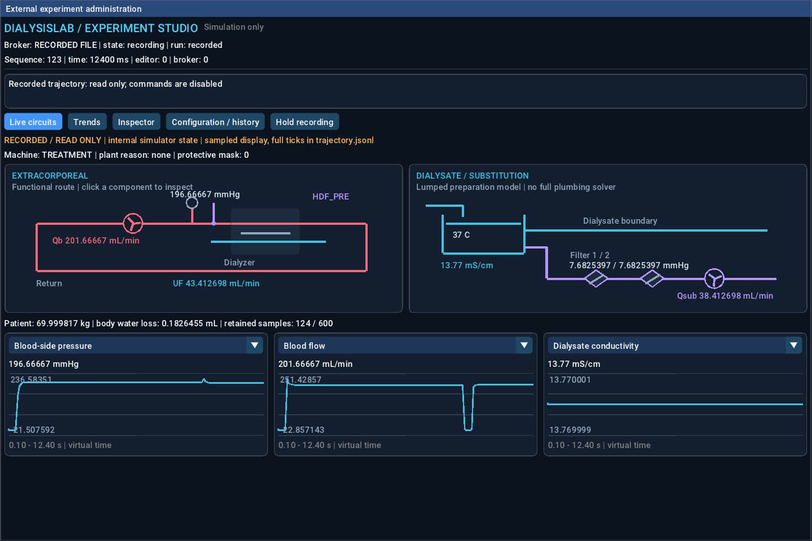
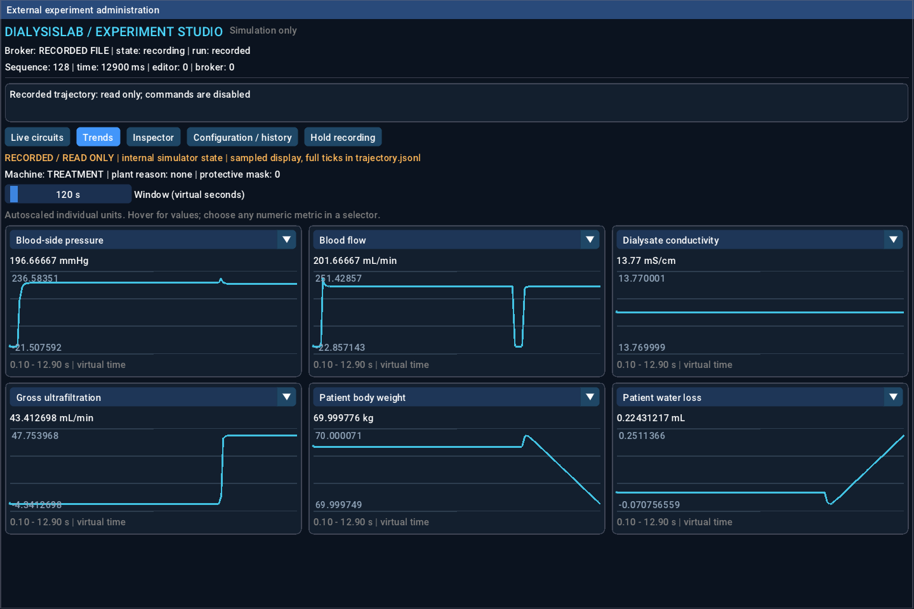
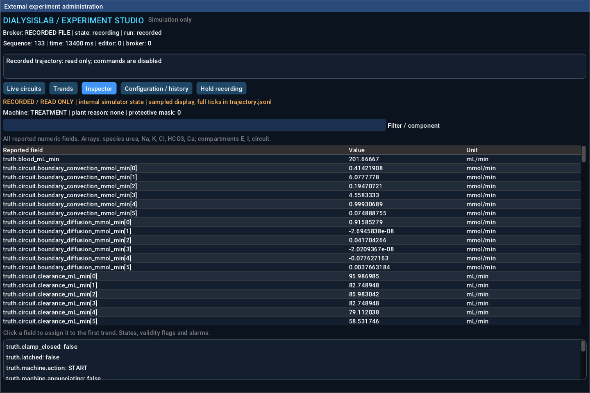

# Visual inspection UI — verification record

The device and external console compile successfully with the pinned LVGL, SDL2
and ImGui dependencies. This host lacked X11 development headers, so verification
used the existing SDL dummy/headless backend (`SDL_X11=OFF` at configure time).
No production backend setting was changed in the repository.

Two new regressions passed: bounded nested telemetry parsing/history/units, and
actual recorded-console widgets (navigation, hold/resume and read-only behaviour).
The history regression inserts 100,000 samples and verifies the 600-sample cap,
512-metric cap, missing values, session resets and discontinuities.
See [test output](tests.md) and [structured report](report.json).

The existing six console regressions and ten device/demo regressions were attempted.
They could not establish live integration: this environment refuses Unix socket
creation (`PermissionError: Operation not permitted`). Service startup errors also
caused downstream test timeouts. These are **blocked checks, not passes**.
WSLg, normal X11 operation, Compose memory limits and live end-to-end behaviour
remain to be tested before merging this UI change.

## Actual rendered views

These are SDL frames from the new console reading an existing synthetic M7
trajectory. They are explicitly labelled RECORDED / READ ONLY. They are not mockups
or screenshots of a newly verified live treatment. Small subsequent graph-range
and device label-position refinements are described in the report.







## Commands

From the repository root, after fetching the existing pinned GUI archives:

```bash
cmake -S . -B build/gui -DCMAKE_BUILD_TYPE=Release -DDIALYSISLAB_GUI=ON -DSDL_X11=OFF
cmake --build build/gui --parallel 3
python3 -m unittest discover -s tests -p test_inspection.py -v
build/gui/sim-console --headless --test-input --recorded assurance/evidence/m7/console-compose/rf932bb95946f35f9/data/trajectory.jsonl --capture-dir build/ui-captures
```

The test-input channel accepts `SNAPSHOT`, `CLICK TAB_LIVE`, `CLICK TAB_TRENDS`,
`CLICK TAB_INSPECT`, `CLICK REPLAY_PAUSE`, `CAPTURE name` and `QUIT`.
It drives actual widget events. Convert PPM captures with `tools/capture_png.py`.
For a supported Linux/WSL2 desktop, omit `SDL_X11=OFF` and use the normal GUI build
prerequisites from the running guide.

No calibration, clinical, human-factors or medical-device conformity claim follows
from these software checks. Existing historical test reports were not rewritten.
