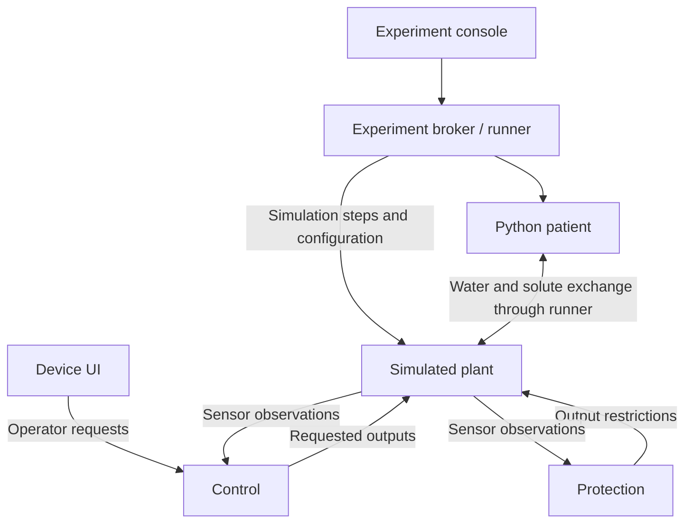

# Software architecture

DialysisLab separates the simulated equipment, the patient and the software that
operates the machine. If you want to understand the fluid paths first, read
[How the simulation works](SIMULATION.md).

## What runs where

| Component | Language | Responsibility |
| --- | --- | --- |
| Plant | C++ | Simulated circuit, pumps, dialyzer and sensor observations |
| Control | C++ | Machine workflow and requested operating settings |
| Protection | C++ | Evaluate modeled hazards and constrain plant outputs |
| Device UI | C++ / LVGL | Operator screens, commands and alarms |
| Patient | Python | Body water, solutes and exchange with the circuit |
| Runner / experiment broker | Python | Configure and advance experiments; save results |
| Experiment console | C++ / Dear ImGui | Separate patient, scenario and experiment controls |

The core can run as separate local processes. Compose deployments separate services
into containers. Communication uses local Unix sockets; these are simulation
interfaces, not connections to real equipment.

This diagram shows responsibilities and information flow, not every socket or reply.
The runner coordinates control and protection steps as well as plant and patient
updates. The [interface reference](M1_INTERFACES.md) defines the exact message order.

## Who can change what

The device UI sends machine requests through control. It cannot set raw actuator
outputs, change patient parameters, inject faults or control simulation time.
The external experiment tools own those experiment functions.

Protection supplies constraints directly to the plant. A control request cannot
cancel a protective restriction. Some hazards stop blood flow; others stop fluid
removal, substitution or exchange while allowing blood flow to continue. The
[machine reference](M5_MACHINE.md) specifies each response and its reset conditions.

Control and protection receive separate modeled sensor channels. Hidden model state
is available to experiment administration, not to the operator as an extra sensor.
The plant owns the authoritative machine state and arbitrates requested outputs.

## Time, failure and results

The runner advances a virtual clock in configured steps. Pausing an experiment
pauses that clock; wall-clock liveness checks continue. A communication failure
must not silently advance treatment as though a reply had arrived. The execution
contracts specify stopping behaviour and distinguish a requested stop from an
acknowledged or observed one.

Each run has a configuration, seed, trajectory and manifest. The trajectory records
the changing state; the manifest records the outcome and hashes needed to identify
its artifacts. A failed run is useful evidence too, so collection must happen before
its container volumes are removed.

## Deployment boundaries

The experiment Compose deployment uses fixed service supervisors to start fresh
roles for each run. It does not mount the Docker socket into the experiment broker.
The device and experiment clients have distinct endpoints and permissions.

Containers provide useful software separation, but share a host kernel and other
common dependencies. Separate processes do not prove independent hardware protection
or medical-device safety. The [security reference](M8_SECURITY_CI.md) describes
implemented controls and remaining findings.

## Further reading

- [Running guide](QUICKSTART.md): native and Docker commands, graphical sessions and recovery.
- [Experiment reference](M7_EXPERIMENTS.md): run lifecycle, replay, export and client permissions.
- [Development checks](DEVELOPMENT.md): verification and source packaging.
- [Decision history](DECISIONS.md): why earlier architectural choices were made.
