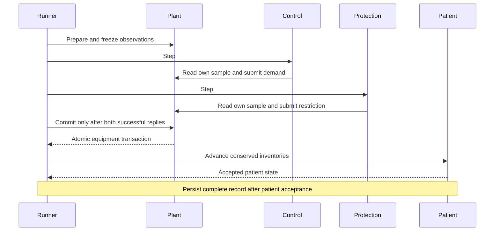

# Architecture: responsibility, boundaries and execution

Document ID SAD-01; revision 1; status: review candidate. Read
[Requirements](REQUIREMENTS.md) first, then [Treatment design](design/TREATMENT.md).
This describes the current corrective candidate based on main `602e8da` and its supported
legacy variants. It is a software architecture, not an electrical safety design.

## Purpose and context

An operator uses the device screen to run a simulated treatment. A researcher uses
the external console to choose the patient, equipment, faults and simulation speed.
The software never connects to real equipment. A generic machine is modeled rather
than a manufacturer's mechanical design. The plant owns the authoritative simulated
machine state; control proposes outputs and protection imposes restrictions.

## Logical components and code ownership

| Component | Responsibility and owned state | Implementation |
| --- | --- | --- |
| Plant process | Frozen observations, pending decisions, actuator arbitration, authoritative phase, alarms and physical circuit | [plant.cpp](../src/plant.cpp), [machine.hpp](../src/machine.hpp) |
| Hydraulic and blood model | Needles, pressures, segment filtration, liquid/gas chambers, pumps and balancing dynamics | [circuit.hpp](../src/circuit.hpp), [blood_physics.hpp](../src/blood_physics.hpp), [dynamics.hpp](../src/dynamics.hpp) |
| Fluid preparation | Mixing, concentrate stocks, heater, conductivity, quality and substitution barriers | [online.hpp](../src/online.hpp) |
| Control process | Validated operator intents and requested blood/gross-UF/substitution outputs | [control.cpp](../src/control.cpp) |
| Protection process | Independent observation evaluation and direct restriction submission; reset intent | [protection.cpp](../src/protection.cpp), hazard rules in `machine.hpp` |
| Patient service | Body/circuit water, six species, red cells and proteins; atomic transaction acceptance | [patient.py](../python/dialysislab/patient.py), [compartments.py](../python/dialysislab/compartments.py), [distributed.py](../python/dialysislab/distributed.py) |
| Runner | Configuration, single virtual clock, ordered exchanges, run termination and records | [runner.py](../python/dialysislab/runner.py), [physical.py](../python/dialysislab/physical.py), [trajectory.py](../python/dialysislab/trajectory.py) |
| Device application | LVGL rendering, phase-aware controls, confirmed requests, telemetry and alarms | [device_ui.cpp](../src/ui/device_ui.cpp), [guided.hpp](../src/ui/guided.hpp), [client.hpp](../src/ui/client.hpp) |
| Experiment service | Immutable run configuration, credentials, runs, pause, replay, compare and export | [experiments.py](../python/dialysislab/experiments.py), [experiment_rpc.py](../python/dialysislab/experiment_rpc.py) |
| External console | Dear ImGui scenario editor, experiment commands and privileged model inspection | [console sources](../src/console), [telemetry.hpp](../src/console/telemetry.hpp) |
| Supervisors and lifecycle helpers | Start fresh services, manage runtime paths and cleanup after owner death | [role_supervisor.py](../python/dialysislab/role_supervisor.py), [child_guard.cpp](../src/child_guard.cpp) |
| Verification and evidence tools | Independent balances, process/container/UI tests, source and dependency identities | [tools](../tools), [tests](../tests), [test plan](testing/PLAN.md) |

The source filenames above are checked by the documentation gate. Shared headers
mean that control, protection and plant do not have independently developed software
implementations. The consequence for common-cause failure is an explicit risk.

## Runtime view: one committed step

Only one tick is in flight. The runner tries both decision services even if one
fails, so the surviving protection path can still act. Any failed STEP reply,
including a reply lost after acceptance, prevents COMMIT. HALT cancels pending
plant decisions. Patient failure after an equipment commit cannot roll the plant
back: the run aborts and records the incomplete transaction rather than claiming
cross-process atomicity. [Interface design](design/INTERFACES.md) explains this seam.

## Deployment and trust view

[Single-run Compose](../compose.yaml) separates plant, control, protection,
patient and runner, with an optional device UI. [Experiment Compose](../compose.experiments.yaml)
uses role supervisors and the scenario broker to create fresh runs; the console
and device UI are optional separate containers. Both use local socket volumes and
no exposed network listener. Native execution uses separate processes on one host.

| Boundary | Permitted authority | Important limit |
| --- | --- | --- |
| Device → control/protection | Requests, confirmation, STOP, alarm handling and observed state | No patient/configuration/fault administration |
| Control → plant | Own observation and actuator demand | Cannot clear protection through a demand |
| Protection → plant | Own observation, restrictions and guarded reset | Shares host, protocol code and simulated sensors with the system |
| Runner → plant/patient/services | Configuration, clock and run coordination | Trusted experiment administrator; not a safety-independent controller |
| Console → broker | Authenticated local experiment operations | Privileged access to simulation truth |
| Host → all containers | Kernel, storage, scheduling and display | Shared failure domain; no hardware independence claim |

Device producer volumes have separate writable ownership; clients mount them
read-only. Immutable aliases preserve `device/control.sock` and
`device/protection.sock`. The broker has no Docker socket. The native same-user
profile cannot provide the same mount-based isolation. X11 and the host account
are trusted. Concrete paths and protocol families are in the interface design.

## Data and physical views

The [hydraulic drawing](images/physical-circuit.svg) describes physical fluid paths;
software sequence diagrams do not substitute for that schematic. Preparation and
filtration are C++; the Python patient retains transported inventories. Local Hct
and protein from the previous accepted patient step feed the next hydraulic solve.
This one-step coupling must be included in convergence studies.

A run contains an immutable configuration, ordered trajectory and a manifest.
Measurements, hidden model state, requested commands and effective outputs have
different meanings and timestamps. A recorded file is not a command channel.
Streaming output bounds memory and incremental hashes identify exact persisted
bytes. Failure collection precedes removal of container volumes.

## Variants and quality attributes

| Concern | Implemented decision | Verification / residual limit |
| --- | --- | --- |
| Model variants | Legacy M1–M5; optional `guided`, `physical`, `physical.dynamics` | Scenario flags, not UI version alone, select behavior |
| Determinism | Integer clock, one in-flight tick, fixed seed and ordered transactions | Same-build replay; cross-build comparison uses declared tolerances |
| Failure containment | Direct protection arbitration, terminal HALT, wall watchdog | Virtual reaction budgets differ from wall-clock liveness; no hard real-time claim |
| Resource bounds | 100000 ticks, streamed records, bounded frames and UI history | Long dynamic-record configurations need their own measured RSS evidence |
| Maintainability | Versioned parsers and preserved historical evidence | Shared headers and broad aggregate requirements complicate impact analysis |
| Security | Bounded parsers, local capabilities, broker credential and identified dependencies | Platform advisories and common-host risks require explicit disposition |
| Portability | C++17/Python 3.9+, Linux/WSL2, SDL display backend | Exact graphical/platform combination must be verified, not inferred from headless tests |

Architecture approval requires a named reviewer, assessed software safety class,
component failure analysis and accepted risk controls. These are not supplied by a
container diagram or a passing CI run; the audit records the outstanding decisions.

Current protective thresholds, failure sequences, trust assumptions and dependency
dispositions are specified in [protective and security design](design/SAFETY_SECURITY.md).

## Optional cold-start concentrate preparation

The `Preparation` component inside the online-fluid model retains source lines,
cartridge gas/liquid/solid/dissolved inventories and two mixed volumes. Its sensor
frames feed two PI dose trims and an availability supervisor; true source inventories
remain inspector-only data. Plant retains final delivery authority after every
internal step. [Detailed design](design/PREPARATION.md) describes this opt-in profile,
OBS11 integration, cold-start treatment guards and its verification boundary.

## Optional complete-browser candidate

The [browser target](design/BROWSER_RUNTIME.md) builds the production device UI
and physical plant as WebAssembly and executes the Python patient through Pyodide.
Its local worker replaces Unix RPC/process scheduling; control and protection reuse
the extracted native handlers with injected local transport. All model computation
runs on the client. The native architecture above remains the reference for process
isolation and service watchdogs; those properties are not inherited by a single
browser worker. [Browser verification](testing/BROWSER.md) and the separate
[dependency exception candidate](dependencies/BROWSER_DEPENDENCIES.md) state the
remaining release obligations.
