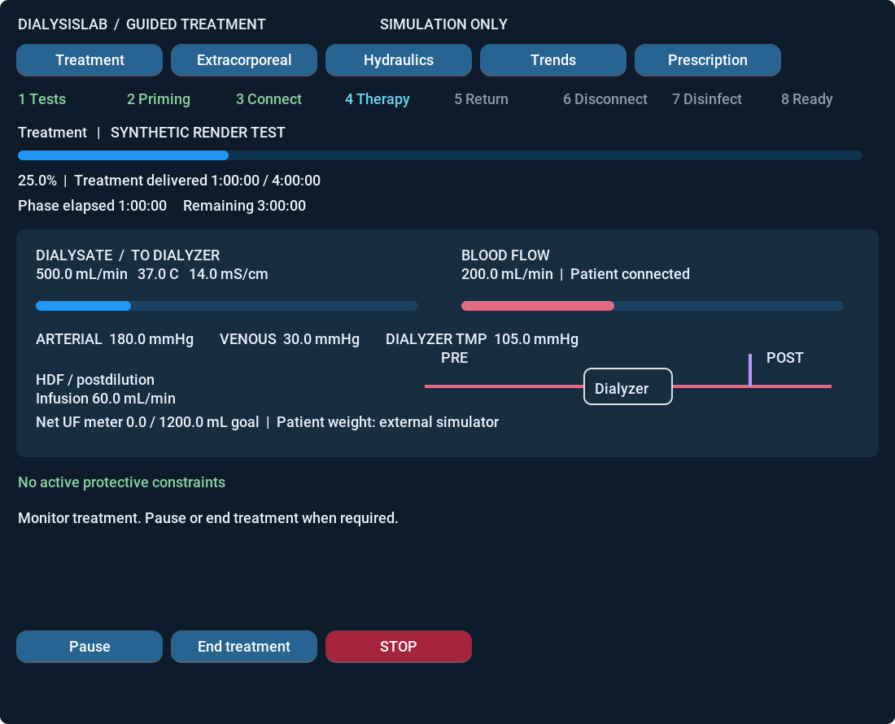

# Follow a treatment from start to finish

The guided device screen follows the machine's treatment phase. It starts with
initial tests and ends with patient disconnection and a simulated disinfection
cycle. The patient and experiment controls remain in the external console.

Run the interactive native demo after building the GUI:

```bash
python3 tools/run_device_demo.py --build-dir build/gui --output build/guided-session
```

The default scenario is `scenarios/device_guided.json`. It uses a four-hour
prescription in virtual time. Close the window to stop the simulation, or use
`--wall-speed 10` to accelerate the experiment. The device screen cannot change
the simulator's clock. Use a new output directory for each run.



The image is an actual LVGL rendering of a synthetic test fixture.

## What happens next?

| Phase | What the simulator does | Operator action |
|---|---|---|
| Initial tests | Checks observation validity, temperature, conductivity, air/leak detectors, filters/integrity, supply and blood-pump response while the patient is isolated. Dialysate preparation runs concurrently. | Wait, or stop if needed. |
| Preparation | Keeps preparing dialysate after the checks pass. | Confirm **Start priming**. |
| Priming | Circulates external fluid through the isolated extracorporeal circuit. Completion uses measured delivered volume. | Wait for the connection phase. |
| Connection | Holds the circuit isolated. | Confirm **Patient connected** after the simulated connection checks. |
| Connected | Shows the prescription; outputs remain stopped. | Review the prescription and confirm **Start treatment**. |
| Treatment | Runs HD, HDF pre or HDF post with control and protection active. | Pause, resume, or end treatment. The prescribed treatment time also ends it automatically. |
| Treatment ended | Stops treatment outputs and waits. | Confirm **Return blood**. |
| Blood return | Feeds modeled saline into the circuit and returns fluid to the patient. UF and substitution remain off. | Wait for the return-volume target. |
| Disconnection | Stops circulation. | Confirm **Disconnected**. |
| Disconnected | Holds the patient isolated. | Confirm **Start disinfection**. |
| Disinfection | Runs an isolated, timed fluid cycle. Both the duration and flushed volume must be complete. | Wait for **Ready for next session**. |

STOP and alarms remain accessible in every tab. The machine rejects operations
that do not belong to its current phase; hiding a button is not the interlock.
After a recoverable stop, recovery checks and protection reset do not restart
pumps. **Resume phase** needs a separate confirmation. Terminal communication
failures and latched faults that cannot be demonstrated clear still require a
new simulation. Completed sessions also start afresh from the external console.

## Home and inspection tabs

**Treatment** is the home page. It shows the phase sequence, current progress,
elapsed and remaining time, dialysate route/flow/temperature/conductivity, blood
flow, arterial and venous model pressures, dialyzer TMP, and pre/post infusion.
A compact line drawing locates the infusion relative to the dialyzer.

**Extracorporeal** and **Hydraulics** contain the detailed circuit views and moving
pump indicators. **Trends** cycles through twelve observed quantities, including
TMP, conductivity, flows and fluid meters. **Prescription** lets you change blood-pump flow and the active substitution
flow while treatment continues. Enter the new values, select **Review prescription**,
and **Confirm**. The effective prescription changes only after the services accept
it; measured flows follow the simulated pump and fluid dynamics. Cancellation leaves
the current rates unchanged. Treatment progress is not reset.

Blood-pump speed is expressed as flow in **mL/min**, not RPM. In HDF PRE the
substitution field controls pre-infusion; in HDF POST it controls post-infusion.
The inactive route stays off; simultaneous pre/post infusion is not modeled.
HD has no substitution. Current simulator bounds are blood 0–500 mL/min,
HDF substitution 2–120 mL/min, and blood + substitution at most 500 mL/min.
These are software bounds, not clinical recommendations.

Changing modality or net UF requires a treatment pause (or prescription before
starting). Live flow editing is disabled on stale/disconnected views or active
protection. Confirmation never clears alarms or resumes stopped treatment.
Restarting blood flow from 10 mL/min or less uses the existing two-cycle pump
and supply-response grace; pressure, air, leak and fluid-quality checks remain
active. Patient configuration is
never edited here.

The net UF meter is compared with the prescribed volume goal. It is **not patient
weight loss**: refill, external intake and returned saline can make these differ.
The external console remains the place to inspect modeled body weight and solutes.

## What the progress indicators mean

- Initial tests combine completed checks with the configured test duration.
- Priming and blood return use delivered volume divided by target volume. Their
  remaining time is an estimate from current observed blood-pump flow.
- Treatment uses delivered treatment time. Pauses and protective interruptions
  do not consume the prescribed treatment duration.
- Disinfection requires elapsed cycle time and flushed volume; the slower
  condition determines progress.
- Manual phases show an outstanding confirmation, elapsed waiting time and
  `--` for remaining time. Paused, stale, invalid or alarm-blocked views do not
  display a running ETA. The progress bar is not proof of clinical readiness.

Change `guided.test_ms`, `guided.treatment_ms`, `guided.disinfection_ms` and
`guided.return_mL` in the scenario to configure a simulation. Existing scenarios
without `guided` retain their original lifecycle and UI for reproducible evidence.

## Model boundaries

These are synthetic equipment checks, not a manufacturer's validated autotest.
The disinfection phase models isolation, circulation, elapsed time and completion
interlocks; it does not predict microbial kill, chemical residuals or validated
thermal exposure. Its completion is not evidence of sterile equipment.

The default scenario uses the [physical model](PHYSICAL_MODEL.md): negative
pre-pump arterial pressure, venous pressure, a pressurized dialysate side and
segmented filtration. TMP includes the dialysate pressure. Older scenarios without
`physical` use their configured resistance network and a zero dialysate reference.

Saline return uses sodium/chloride 154 mmol/L and zero other tracked solutes.
The patient tracks water, solutes, red-cell volume and protein mass when the
physical profile is enabled. Remaining circuit cells and cells sent to waste are
retained explicitly; the return-volume target is not a guarantee of full recovery.

`OBS9` adds the pre-pump pressure, flow-limitation status, dialysate pressure,
heater power, remaining supplies and raw conductivity. The physical guided UI
provides eighteen selectable trends. `OBS10` adds chamber levels, drain and UF-pump flow,
balancing displacement, bypass and valve phase; the dynamic model offers 24 trends. Patient hematocrit remains external to the
device UI and cannot be prescribed there.

Versioned `MACHINE8` and `OBS8` frames add phase timing, patient connection,
return transfers, initial-check status, observed dialysate flow and TMP. Legacy
frames remain readable. Each committed guided record retains both the phase
integrated during that interval and the resulting phase, avoiding an ambiguous
water/solute balance on automatic transitions.
