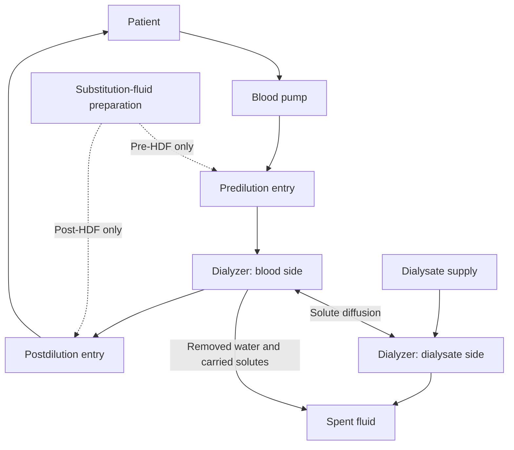
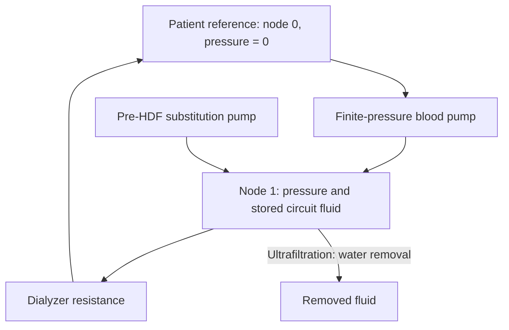
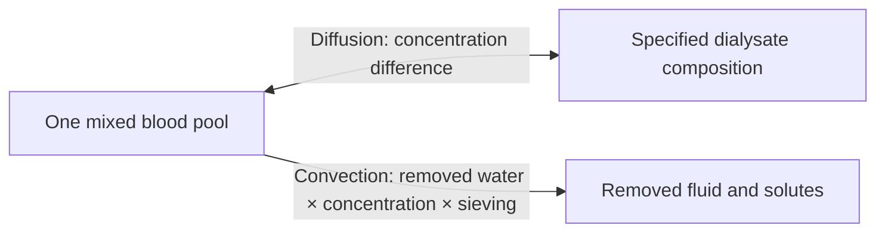
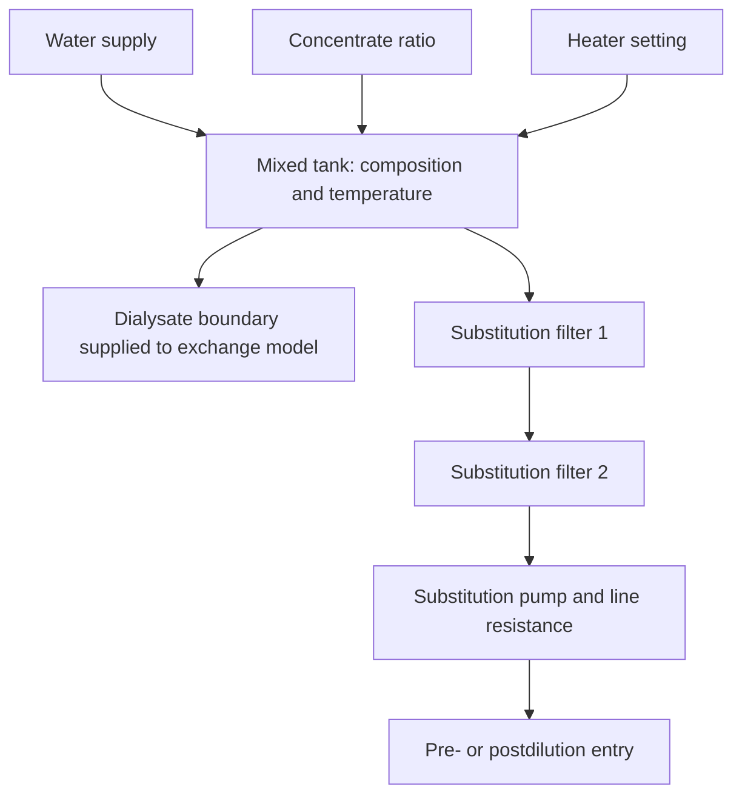
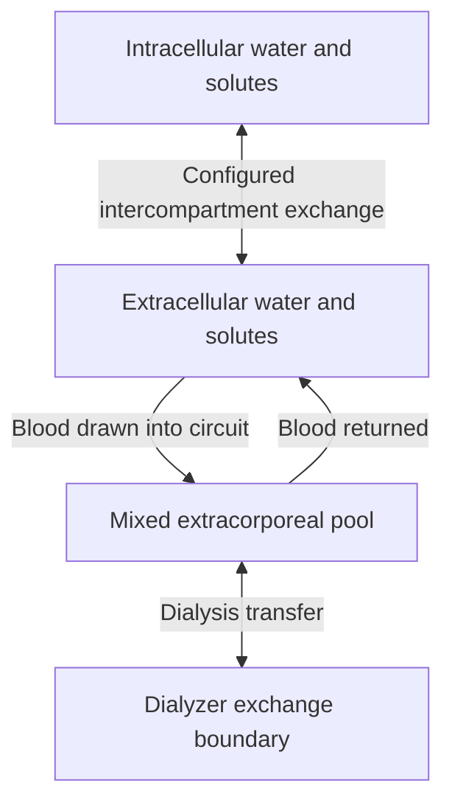

# How the simulation works

DialysisLab calculates how fluid and dissolved substances move between a simulated
patient and a dialysis circuit. It advances in small time steps: the machine requests
pump settings, protection can restrict them, the circuit calculates flows, and the
patient model updates water and solutes.

The diagrams below describe the **implemented simulation**, not a construction
plan for a medical device. GitHub renders them directly; a Markdown viewer needs
Mermaid support to display them.

## Follow the fluids

There are three paths to keep distinct:

- **Blood:** leaves the patient, passes through the extracorporeal circuit and dialyzer, and returns.
- **Dialysate:** provides the fluid composition and flow on the other side of the dialyzer membrane.
- **Substitution fluid:** in HDF, adds replacement fluid to blood before or after the dialyzer.

The membrane allows water and selected solutes to cross. Blood and dialysate are
not represented as one mixed fluid.

This first diagram shows treatment routes. It does **not** mean that every box has
its own hydraulic pressure state. The numerical representation is smaller, as below.

## How pressure and blood flow are calculated

The hydraulic solver represents a circuit as pressure nodes connected by resistances.
A node can store fluid through **compliance**: its stored volume changes with pressure.
An edge carries flow according to the pressure difference divided by its resistance:
`flow = (upstream pressure − downstream pressure) / resistance`.

The supplied `machine_hdf_pre.json` scenario has just one pressure node and one
resistive edge. That edge represents the dialyzer. Node 0 is a fixed zero-pressure
reference for the patient connection; it is not a cardiovascular model.

The pump setting is a requested flow. Actual flow falls as the opposing pressure
approaches the pump's configured pressure capability. Closing a modeled edge stops
flow through that edge. Compliance gives the pressure a transient response rather
than making it jump immediately to its final value.

You can configure a larger graph with different resistances, compliance values,
pump locations and sensor locations. The default graph does not separately represent
arterial tubing, venous tubing, a drip chamber or pressure losses in every connector.
Air and blood-leak alarms use modeled signals/faults; there is no simulation of
individual air bubbles travelling through tubing.

The solver checks the fluid balance each step: fluid entering must equal fluid
leaving plus the change in stored fluid. It uses an implicit time-step calculation
(backward Euler) to handle fast pressure changes.

## What the dialyzer model does

A dialyzer profile supplies three kinds of parameter:

| Parameter | Effect in the simulation |
| --- | --- |
| Blood-side resistance | Pressure drop for a given blood flow |
| Water permeability (KUF) | Limits water removal for the available pressure |
| Solute transfer capacity (KoA) and sieving | Determine diffusion and how much solute accompanies removed water |

For diffusion, the model combines blood flow, dialysate flow and KoA into an
effective clearance. A concentration difference drives transfer: a substance can
leave blood or enter it, depending on which side has the higher concentration.
The six modeled substances are urea, sodium, potassium, chloride, bicarbonate and calcium.

Water removal is limited by the request, available blood-pump demand and a
pressure-dependent permeability calculation. The model assumes zero dialysate-side
pressure for this calculation and does not include oncotic pressure.

There is no spatial model of hollow fibres or countercurrent concentration profiles.
The supplied dialyzer profiles are synthetic examples, not calibrated commercial
cartridges. Changing profiles demonstrates how parameters affect the calculation;
it does not establish performance for a manufacturer's dialyzer.

For the equations and units, see the [hydraulic and dialyzer reference](M2_MODEL_INTERFACES.md).

## HD, predilution and postdilution HDF

**HD** uses dialysate exchange and prescribed water removal without substitution fluid.
**HDF** adds substitution fluid and removes additional fluid through the dialyzer.

In **predilution**, substitution enters the modeled circuit before the dialyzer.
It changes the circuit water and solute balances, and its delivered flow depends on
circuit pressure. In **postdilution**, substitution is added directly to the patient's
extracellular compartment, representing return after the dialyzer. A separate
postdilution line volume is not modeled.

Gross ultrafiltration is the water removed at the dialyzer. Net removal must also
account for delivered substitution. Consequently, increasing gross ultrafiltration
does not necessarily cause the same increase in patient weight loss.

### Online fluid preparation

The tank calculation updates mixture composition and temperature. A conductivity
estimate is derived from the ionic composition. Filters contribute resistance and
reduce a synthetic contamination indicator; injected faults can model filter breaches.
This is not a microbial or sterility model.

Unlike the configurable blood-side graph, the dialysate supply is represented by
mixing equations and boundary values. There is no complete pressure network for
water treatment, balancing chambers, dialysate plumbing or drains. Temperature
belongs to the preparation model; it is not a whole-patient heat-transfer simulation.
See the [treatment reference](M4_TREATMENT.md) for the exact calculations.

## How the patient changes

The Python patient model has two well-mixed body compartments and one circuit pool:

Each compartment tracks water volume and the six solute amounts. Concentrations
follow from amount divided by volume. Blood withdrawal and return exchange these
amounts with the circuit. The circuit pool includes priming volume and the changing
stored hydraulic volume. Even with several hydraulic nodes, the chemistry still
uses one mixed circuit pool.

Patient presets change initial volumes, concentrations and exchange parameters.
A configurable relaxation model moves water between body compartments. It is not
a model of osmotic pressure, circulation or physiological fluid regulation.

**Reported body-weight change comes from body-water change**, using 1 litre ≈ 1 kg
and keeping non-water mass fixed. It is not simply the integral of the UF setting:
substitution, circuit filling, return and any configured external fluid inputs or
outputs also matter. The patient solver keeps the authoritative water and solute
balance; instantaneous dialyzer flux estimates are not a second removal to apply.

The illustrative pH calculation assumes fixed carbon-dioxide pressure. There is
no full acid–base, cardiac, red-cell or active electrolyte-regulation model.
See the [patient reference](M3_PATIENT.md) for equations and configuration fields.

## Try it and inspect the result

Run the [README example](../README.md#run-your-first-simulation), then open the
output directory. `manifest.json` describes the run and its outcome;
`trajectory.jsonl` contains the sequence of states and measurements.

Compare `scenarios/machine_hdf_pre.json` with `scenarios/machine_hdf_post.json`
to inspect the two substitution configurations. Scenario times are virtual times:
a short example is not a complete clinical treatment. Parameter values and alarm
thresholds are test settings, not treatment recommendations.

To change a patient or inject a fault interactively, use the external
[experiment console](M7_EXPERIMENTS.md). Those controls deliberately do not appear
in the machine operator interface.
