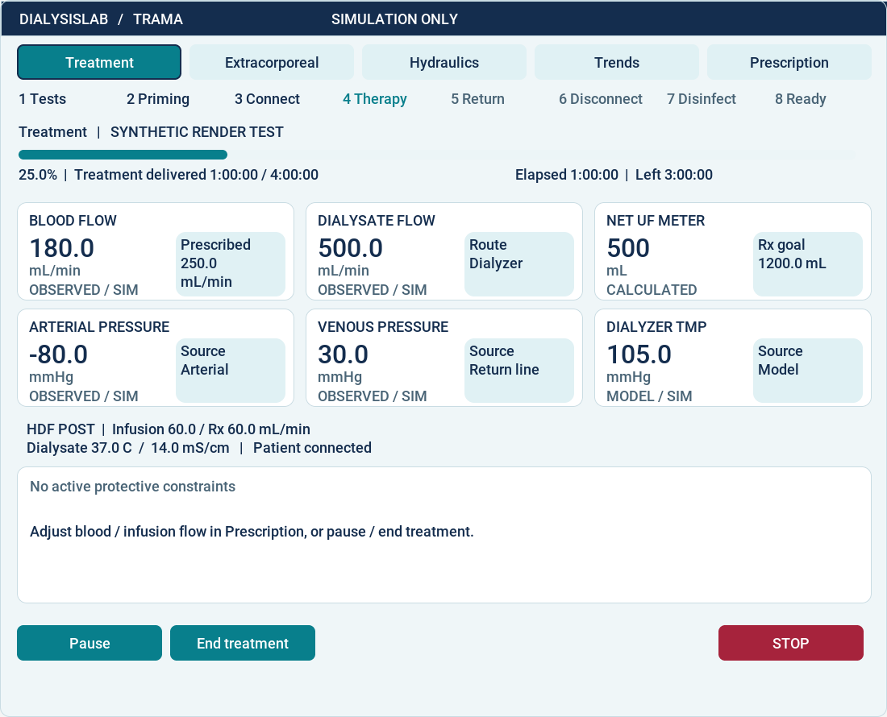

# Detailed design: device UI and experiment console

Document ID SDD-04; revision 1; review candidate. Requirements: REQ-001/005,
M6-REQ-001…006, M7-REQ-001…006, UI-REQ-001/002.
Previous: [Interfaces](INTERFACES.md). Next: [Test plan](../testing/PLAN.md).

## Two users, two authorities

The LVGL application represents a machine operator. It receives sensor observations
and authoritative machine metadata, and requests permitted operations. The Dear
ImGui console represents a researcher with access to patient configuration, hidden
model state and experiment time. Keeping them separate prevents experimental controls
from appearing as medical-device operations. It does not establish usability approval.

The device application selects its guided screen when metadata carries the guided
state. Recompiling alone does not activate it: use `scenarios/device_guided.json`.
The external console starts from `physical_hd`. Its preset list includes the
scheduled `physical_hd`, `physical_hdf_pre` and `physical_hdf_post` profiles, together
with supported legacy machine presets. Each physical profile has a complete guided
workflow and dynamic patient/plant configuration. `device_guided` is deliberately
absent from this scheduled list: it is the interactive operator route and has no
automatic workflow. Loading a preset replaces only the draft; START freezes a new
run. Active experiments cannot be changed by later draft edits.

## Device information hierarchy

The [guided view](../../src/ui/guided.hpp) has a persistent phase sequence,
progress bar, percentage, elapsed time, remaining-time estimate and contextual next
operation. [Treatment design](TREATMENT.md) specifies their exact meaning.

| Area | Content | Reason |
| --- | --- | --- |
| Treatment home | Dialysate route/flow/temperature/conductivity, blood flow, arterial/venous pressure, TMP, PRE/POST position and net UF meter | Understand current treatment without navigating a full engineering schematic |
| Extracorporeal | Blood path, animated pump, chamber levels and pressures | Inspect local fluid behavior |
| Hydraulics | Preparation, dialysate paths, balancing state, UF pump and bypass | Inspect delivery and pressure regulation |
| Trends | 24 selectable dynamic-model measurements, bounded time history | Compare changes rather than isolated samples |
| Prescription | Current values, input units, permitted edits and confirmation | Separate editing from effective operation |
| Persistent controls | STOP, alarm state and permitted handling | Access safety-related interaction from each tab |

Animations are derived from simulated observations; they are not proof of real
movement. The net UF meter is not patient weight. Patient composition and initial
hematocrit remain outside the device UI. Missing/invalid/stale observations require
a visible unavailable/held indication, not fabricated current zero values.

## Trama / Atlantico visual system

The guided LVGL screen uses an original two-register tile: the left register
contains an observed simulated value and unit; the pale right register names its
reference. Blood flow uses the effective prescription, dialysate flow its route,
and the calculated net UF meter its prescription-derived volume goal. Pressure
tiles identify the source instead of inventing clinical limits. In non-physical
models the arterial tile explicitly identifies its pre-filter source. The net
meter is gross UF minus substitution, not body-weight loss.

Six tiles expose blood/dialysate flow, net UF, arterial/venous pressure and TMP.
The persistent home strip adds PRE/POST infusion with effective prescription,
temperature, conductivity and patient connection. Current, stale/held and unavailable
values have textual labels. Stale or invalid tile values and prescription
references are suppressed; the chart retains historical observations. The separate
circuit views retain diagnostic observations with the channel status and held
animation, and are not substitutes for the current-value registers.

| Token | Color | Role |
| --- | --- | --- |
| Ink | `#142D4E` | Masthead, primary text and numerals |
| Accent | `#087F8C` | Actions, selected tab, progress |
| Ice | `#EFF6F8` | Screen background |
| Surface | `#FFFFFF` | Tiles and confirmation |
| Reference | `#E0F1F4` | Reference register and inactive tabs |
| Muted | `#496476` | Units, source and neutral status |
| Border | `#C9DCE3` | Tile boundaries |
| Protection | `#A6233C` | Alarm text and STOP |

Roboto Medium remains the existing Apache-2.0 font. Numeric registers add a
32-pixel digit raster from the same verified source; labels retain 18 pixels.
No new runtime font or dependency is introduced. Selected tabs have a border as
well as a color change. Circuit path colors identify fluids; they do not encode
alarm priority. The theme does not change phase eligibility, prescription
confirmation, protection authority or the independent experiment console.

The image above comes from the actual LVGL synthetic renderer fixture, not live
services. Candidate verification: GUI build and four guided unit/in-process tests
passed, including all-phase eligibility, observed/prescribed registers, stale and
invalid values, alarm layout and five-tab rendering. Thirty-one dependency,
publication and documentation tests passed. Process UI regressions could not
complete in the editing environment because Unix sockets return `EPERM`; rerun
`PYTHONPATH=tests python3 -m unittest ui_regressions -v` on a supported host.

Historical screenshots remain evidence of their original revision, not of this
visual system. Current renderer and process tests are required for each candidate.

## Command lifecycle

1. The operator selects an action or edits values. The application shows intent.
2. Control/protection validates syntax and creates a bounded pending confirmation.
3. Confirmation queues that exact action; it expires after 10 wall seconds.
4. The relevant service applies it at its defined step boundary. Plant guards
   independently accept or reject it against current state.
5. The screen observes the result and new effective revision; a queued reply is
   never displayed as proof of applied treatment.

STOP takes the immediate path and cancels pending control intent. Session changes
invalidate confirmations and histories. An ambiguous lost critical reply is not
automatically retried. These rules prevent a delayed confirmation from applying
to a different session or silently resuming treatment after recovery.

In scheduled experiments, SCHEDULE7 locks ordinary device mutations; the trusted
runner forwards scheduled operator actions. Device STOP remains available. The
console's pause freezes virtual time but keeps watchdog heartbeats running. This
is different from the device's treatment pause state.

## External experiment lifecycle

[Broker](../../python/dialysislab/experiments.py) validates a draft and freezes a
complete configuration for each run. New runs get fresh processes, sockets and
identities. Replay uses recorded inputs; compare checks identities and trajectory
hashes; export streams bounded named artifacts. Draft changes cannot alter an
active patient. Restart does not silently resume an interrupted treatment.

[Console telemetry](../../src/console/telemetry.hpp) bounds history to 300 samples
and 1024 numeric metrics per sample. The live device guided trend history is also
bounded. Inspection of recorded trajectories is read-only; a replay file cannot
become an actuator command channel.

## Verification and limits

[Guided widget tests](../../tests/guided_view.cpp) check actual LVGL layout/actions
and progress; [UI regression helpers](../../tests/ui_regressions.py) exercise real
inputs, including live-flow confirmation revision handling. Dedicated device and
console verification tools retain rendered captures and command results. Headless
rendering is not evidence of WSLg display behavior or representative-user success.

Missing evidence includes human critical-task validation, alarm audibility and a
complete approved accessibility/usability specification. See [workflow tests](../testing/WORKFLOW.md)
and [audit](../../assurance/audits/DOCUMENTATION_AUDIT.md). No screenshots or numerical
contrast checks close those human-performance obligations.
