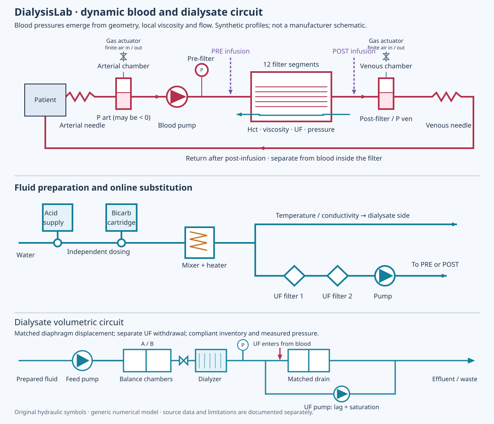

# Detailed design: fluids, blood and the patient

Document ID SDD-02; revision 1; review candidate. Requirements: REQ-003/006,
M2-REQ-001…004, M3-REQ-001…004, M4-REQ-001…004, PHY-REQ-001, DYN-REQ-001.
Previous: [Treatment](TREATMENT.md). Next: [Interfaces](INTERFACES.md).

Read the [glossary](../GLOSSARY.md) for units. A configuration bound means the
software accepts an input; it does not establish biological validity at that input.

The drawing is a hydraulic reference for the generic machine. It is not a block
diagram, piping specification for manufacture or a particular commercial machine.

## Choose the model before interpreting an equation

| Scenario choice | Hydraulic / transport model | Source |
| --- | --- | --- |
| M1 | Limited prescribed-flow/resistance and fluid ledger | [M1](../M1_MODEL.md) |
| Circuit without `physical` | Compliant resistive graph, mixed dialyzer exchange | [M2](../M2_MODEL_INTERFACES.md), [circuit.hpp](../../src/circuit.hpp) |
| `physical`, without dynamics | Geometry/rheology and segmented filtration; older mixed inventories | [blood_physics.hpp](../../src/blood_physics.hpp), [physical configuration](../../python/dialysislab/physical.py) |
| `physical.dynamics` | Gas/liquid chambers, dialysate control, 16 blood and 12 dialysate inventories | [dynamics.hpp](../../src/dynamics.hpp), [distributed.py](../../python/dialysislab/distributed.py) |

`guided` selects lifecycle behavior independently of those physical choices. The
interactive default enables both guided and dynamic physics. Avoid interpreting
M2's algebraic clearance or zero dialysate-pressure convention as the current
distributed transport law.

## Preparation: from water and stocks to prepared fluid

[Online::advance_physical](../../src/online.hpp) mixes separate acid and bicarbonate
sources. Available acid volume and bicarbonate mass are finite. Bicarbonate supply
is also bounded by dissolution rate. The mixed reservoir uses an implicit mass
balance; unavailable stocks do not magically preserve the desired composition.
The preparation source boundary is external to the patient's conservation ledger.
Stock accounting is not a full machine-water/chemical-waste inventory.

The thermal balance includes incoming fluid, reservoir and heater thermal storage,
ambient loss and power capped at `heater_max`. Fluid heat capacity is modeled as
4.18 J/(mL K). Feed-forward heating plus proportional feedback selects bounded power;
a large flow or cold inlet can make the temperature target unattainable.

Conductivity is a weighted sum of the modeled ionic concentrations, multiplied by
a generic mixture factor. Raw conductivity includes `1 + alpha*(T-25)`; the displayed
compensated value divides out that factor. These are synthetic constitutive choices,
not an electrolyte-specific calibrated conductivity instrument. Acid/CO2 chemistry
and electroneutrality are not solved. Constant pCO2-derived acid/base indicators
cannot be treated as validated patient acid/base predictions.

The two serial substitution-filter barriers have pressure loss, integrity signals
and contaminant penetration factors. Hidden contamination is retained as simulation
truth; it must not acquire an imaginary protective sensor. Pressure/integrity checks
do not establish microbiological safety or online-fluid sterility.

## Blood pressure and membrane water transfer

Needle/tube resistance follows a Poiseuille diameter-to-the-fourth law. The default
blood viscosity is the synthetic high-shear approximation
`mu = 1.2 exp(-0.025*(T-37)+0.04*(Cp-7))/(1-Hct)^2.5` in mPa s.
Oncotic pressure is approximated by `pi = 2.1*Cp + 0.16*Cp^2 + 0.009*Cp^3`
in mmHg with protein concentration Cp in g/dL. Coefficients require measurements
at documented fluid, temperature and shear conditions before quantitative use.

The filter has twelve segments. Each computes forward filtration
`UF_i = max(0, (KUF/12)*(Pb_i-Pd_i-pi_i))`. Pressure loss and hemoconcentration
are coupled. Pump head, dialysate pressure, hematocrit and filtration-fraction
limits bound the admissible result. The iterative solve explicitly detects failure
to converge and stops outputs; it must not silently return an unconverged target.
Backfiltration and time-varying membrane fouling are absent.

## Chambers, pumps and dialysate balancing

A chamber has liquid volume and a compressible gas pocket. The implementation uses
`(760 + gauge_pressure)*gas_volume = gas_inventory`. A bounded gas actuator adjusts
inventory to regulate liquid level. Liquid continuity and pressure are solved
implicitly, so arterial draw, pump flow and venous return can differ while chamber
volumes change. Isolation freezes retained volumes in this simulator.

In dynamic transport, POST substitution enters the venous chamber before the
venous tubing and patient return. The chamber assumes perfect mixing of its liquid;
its gas pocket is not an entrained-bubble transport or separation model. Bubble
capture efficiency, degassing and mixing-induced air-detector signals are absent.
Level-alarm tests therefore do not verify bubble-trap performance. See the
[topology correction and scoped tracer check](ANIMATED_SYNOPTIC.md).

Pump and pressure sensor responses have finite time constants. Two ideal matched
balancing chambers displace equal fresh and spent volumes; changeover holds flow
for 30 ms. An extra UF pump controls dialysate removal. Dialysate storage is
`C*(Pd-Pd_initial)`, with balance `change = feed + membrane_UF - drain`.
An implicit pressure/filtration solve couples that storage to the blood filter.
Controller pressure is a setpoint, not an imposed pressure that guarantees target UF.
A bounded solution may isolate the membrane and report a limitation.

The gas reference, ideal matched displacement and quasi-steady liquid momentum are
model assumptions. Pressure waves, mechanical valve leakage and independent balancing
meter error are not represented merely by showing animated valves.

## Conserved transport and patient coupling

The distributed blood compartments are arterial tube, arterial chamber, twelve
filter segments, venous chamber and venous tube. PRE enters the first filter segment;
POST enters the venous chamber. Twelve dialysate cells normally flow countercurrently.
During a balancing-valve hold, local filtration and compliant storage can temporarily
reverse flow between two dialysate cells. The implicit transport uses the concentration
of the actual donor cell on each face; the same transferred mass leaves that cell and
enters its neighbour. External feed and drain remain nonnegative. This is internal
fluid redistribution, not membrane backfiltration or reverse flow into the supply.
See the [flow verification protocol](../testing/FLOW_REFINEMENT.md).

Recorded `feed_mL_min` and `drain_mL_min` are transferred volume divided by the
current tick duration. They are interval averages, not instantaneous samples. A
30 ms valve closure affects a 25 ms average differently from a 400 ms average;
compare integrated volumes or averages over identical observation windows.
The Python solve retains red-cell volume, protein mass and six solute inventories.
Red cells/proteins do not cross the membrane. Solutes cross by local diffusion and
sieved convection. Concentration times volume, with the unit conversion, gives mass.

[Compartments](../../python/dialysislab/compartments.py) retains body pools and a
vascular/tissue split for hemodynamic effects. Refill redistributes fluid internally;
it does not create whole-body water. Patient weight tracks water balance, including
external intake and saline return. It is not simply prescribed UF times duration.

Implicit finite-volume transport limits numerical instability but does not prove
accuracy. Local blood properties from the preceding accepted step drive the next
hydraulic solve. Grid size and time step affect effective coefficients and transit
delay. [Distributed::solve](../../python/dialysislab/distributed.py) uses pivoted
linear solves; invalid prospective states are rejected before replacing patient
state. The global run still has the post-plant-commit failure seam described in
[Interfaces](INTERFACES.md).

## Numerical acceptance and calibration

Independent whole-system water and six-species balances use the declared 1e-6
mL/mmol tolerance in integrated protocols. Red-cell/protein ledgers and dialysate
storage have their own checks. Conservation alone is insufficient: a wrong model
can conserve perfectly. Compare analytic cases, step/grid convergence, limiting
cases and independently collected measurements.

[The reference-fit tool](../../tools/calibrate_models.py) fits urea KoA to a public
300 mL/min point and holds out 400 mL/min for comparison, at stated Qd/temperature.
Three profiles supply KUF and blood priming volume. Source, units and incomplete
fluid/uncertainty details are recorded in the [reference register](../../references/dialyzer_benchmarks.json).
This is a conditional in-vitro fit, not patient validation. Other solutes, rheology,
chamber actuators, preparation, controller and refill parameters remain uncalibrated.
A future Excel measurement/import workflow is not present in this baseline.

Verification: [model protocol](../testing/MODELS.md), [physical tests](../../tests/test_physical.py),
[dynamic tests](../../tests/test_dynamics.py), [independent verifier](../../tools/verify_models.py).
Clinical data, uncertainty bounds and declared validated operating envelopes remain
open. Scientific references informing the structure are linked in
[Physical model](../PHYSICAL_MODEL.md); they are not validation of this implementation.
