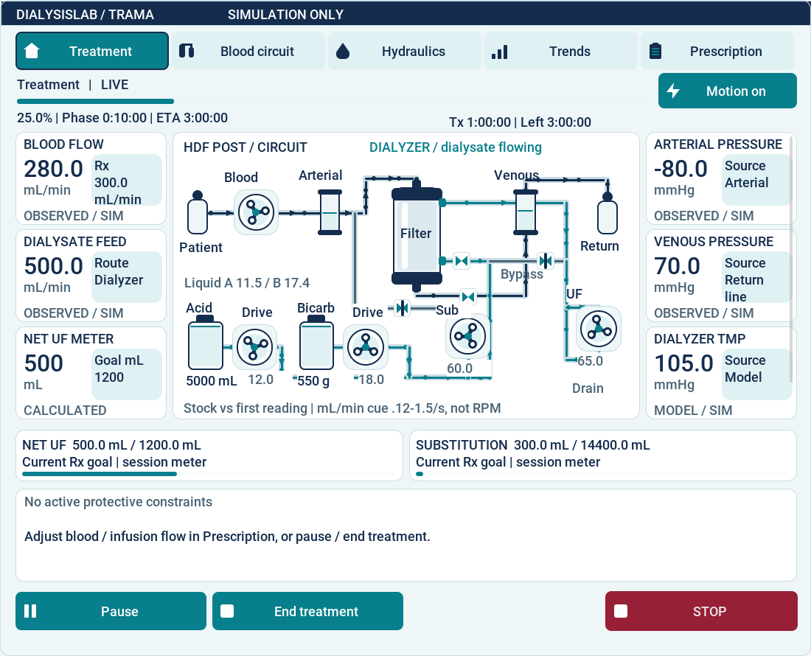

# Animated synoptic verification

Document ID STP-SYN-01; 2026-10-15; engineering review candidate.
Requirements and predeclared checks: [SYN-REQ-001–008](../design/ANIMATED_SYNOPTIC.md).

## Reproduction

Use the pinned GUI archives and existing dependency policy, then build the real GUI:

```sh
python3 tools/fetch_gui.py --cache build/gui-deps
cmake -S . -B build/gui -DDIALYSISLAB_GUI=ON -DCMAKE_BUILD_TYPE=Release
cmake --build build/gui --parallel 4
DIALYSISLAB_SYNOPTIC_CAPTURES=build/synoptic-captures python3 tools/verify_synoptic.py --output build/synoptic-report.json
python3 tools/verify_synoptic.py --check build/synoptic-report.json
python3 tools/verify_preparation.py --output build/preparation-after-ui.json
```

Choose new output paths; preserve failed runs. The UI recorder refuses success if
any selected case is skipped, fails, or source inputs change during execution.
It records exact source/configuration SHA-256 values, Git base, dirty state, compiler,
LVGL/build identity, case names and outputs. A dirty base commit is not passed off
as the executed commit. `--check` rejects changed inputs. The surrounding Git tree
identifies the published documentation and evidence as well.

| Procedure | Coverage |
|---|---|
| `test_synoptic.SynopticTests.test_motion_freshness_routes_and_inventory` | Linear range/clamps; zero/restart; phase continuity; bounded frame gap; stale/recovery; modeled drive vs dry output; route unknown/bypass; reduced motion; inventory/session reset and same-epoch reconnect |
| `test_synoptic.SynopticTests.test_actual_lvgl_modes_responsive_touch_and_stale` | Actual LVGL pixels change with motion; HD/PRE/POST at 800x890, 1100x890, 1440x1000; bounds, icon plus text, target height, STOP hit-test; pause totals; stale, bypass, old telemetry, reduced motion and reset |
| `test_synoptic.SynopticTests.test_sdl_resize_finger_input_and_focus_cancellation` | Actual SDL dummy-window resize, single-finger ownership, duplicate mouse suppression, focus-loss cancellation and confirmation label dimensions |
| `test_guided.GuidedUnitTests` | Existing lifecycle/interlocks, observed-vs-prescribed rendering, three real Plant/patient cycles over pipes and fluid balances |
| `test_document_contracts.WireWitnessTests` | Actual C++ serializers and Python decoder; all numeric boundaries, non-finite/truncated/extra frames; OBS5–12 compatibility; drive vs dry liquid |
| `tools/verify_preparation.py` | Re-execution of the existing preparation campaign after observation-only changes; does not renew independent acceptance |

## Execution and open acceptance

Twelve UI/guided/protocol tests and eighteen preparation tests passed locally,
with zero skips in both input-bound reports. The production core and GUI compile
with the repository warning-as-error flags. Actual captures at all three sizes
were visually inspected, including alarm, stale, bypass and prescription states.



[Narrow layout](../images/animated-synoptic-narrow.png) and
[bypass state](../images/animated-synoptic-bypass.png) are project-rendered synthetic fixtures.

Current source-bound outcomes are recorded in
[the UI report](../../assurance/evidence/animated-synoptic/report.json) and
[preparation regression report](../../assurance/evidence/animated-synoptic/preparation.json).
[Development checks](../../assurance/evidence/animated-synoptic/development.json)
retain earlier failures and environmental blocks. These are synthetic technical
checks, not a representative-user study or approval of the proposed visual limits.

Real Unix-socket services cannot run in the local execution sandbox (`EPERM`).
The attempted full regression run was interrupted after this repeated block;
no full-suite pass is claimed. Current-head hosted CI must verify service/GUI and
container integration. Physical touch hardware, display density, readability at
viewing distance, user comprehension of drive versus liquid flow, alarm handling
and reduced-motion usability still require independent assessment.

The numerical verification obligation `CLOSE-NUM-01` remains open. UI motion and
meter conservation are not evidence of global numerical accuracy, experimental
agreement, clinical validity or a certified device.
